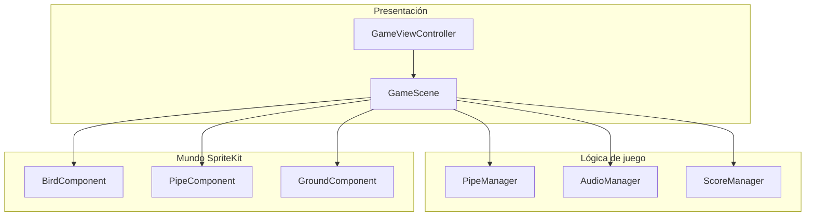

# 2. Arquitectura del sistema

## 2.1 Visión general

El núcleo de gameplay es una única escena SpriteKit, **`GameScene`**, dividida en **extensiones por responsabilidad** para mantener archivos manejables. Los elementos móviles y repetitivos (tubos, suelo, fondo, coleccionables) viven en **`Components`**, y los datos compartidos y configuración en **`Models`** y **`Utilities`**.

## 2.2 Extensiones de `GameScene`

Ubicación: `Fluttor/FluttorGame/Scenes/`

| Archivo | Responsabilidad principal |
| ------- | ------------------------ |
| `GameScene+Setup.swift` | Construcción inicial de nodos y componentes |
| `GameScene+Lifecycle.swift` | `didMove`, cambio de tamaño, ciclo de vida |
| `GameScene+Update.swift` | `update(_:)` por frame |
| `GameScene+Physics.swift` | Contactos, game over, registro de puntuación |
| `GameScene+Input.swift` | `touchesBegan`, bienvenida, pausa, salto |
| `GameScene+Score.swift` | HUD de puntos |
| `GameScene+UI.swift` | Elementos de interfaz en partida |
| `GameScene+Pause.swift` | Pausa y retorno al flujo de inicio |
| `GameScene+Welcome.swift` | Pantalla de bienvenida, nombre, modo de juego |
| `GameScene+GameOver.swift` | Game over, reinicio visual, puntuaciones |
| `GameScene+Restart.swift` | Reinicio de estado |
| `GameScene+DayNight.swift` | Variantes día/noche del escenario |

La lista puede evolucionar; ante duda, el inventario real está en el directorio anterior.

## 2.3 Módulo `Components`

- **`Entities/`**: piezas del mundo (`BirdComponent`, `PipeComponent`, `GroundComponent`, `BackgroundComponent`, componentes de frutas, sol, luna, moneda, etc.).
- **`Managers/`**: `PipeManager`, `AudioManager`, `ScoreManager`, `PhysicsManager`.
- **`UI/`**: componentes reutilizables (`TextInputComponent`, `UIComponent`).

## 2.4 Modelos y configuración

- **`Fluttor/Models/`**: `GameConfing.swift` (configuración del juego; nota: nombre de archivo con convención histórica), `PhysicsCategory`, `Pipe`, `Ground`, `Background`, `GameState`, `Player`, etc.

## 2.5 Punto de entrada de la aplicación

- **`AppDelegate`**, **`SceneDelegate`**, **`GameViewController`**: creación de la vista SpriteKit y presentación de la escena. El SDK de iOS 27 exige el ciclo de vida **UIScene**: `AppDelegate.application(_:configurationForConnecting:options:)` devuelve una configuración cuyo delegado es `SceneDelegate`, que crea la `UIWindow` y carga `Main.storyboard`. Sin ello la app arranca en pantalla negra.
- **`GameViewController+TextInput`**: entrada de texto del sistema para el nombre del jugador en la bienvenida.

## 2.6 Pruebas

- **`FluttorGameTests/`**: tests del target (import `@testable` según nombre del módulo en Xcode).
- **`FluttorGameUITests/`**: pruebas de interfaz.
- **`ScoreTest.swift`**, **`SoundTest.swift`**, **`FontTest.swift`**: utilidades de depuración / verificación en desarrollo.

## 2.7 Documentación simbólica (DocC)

El catálogo **`Components.docc`** describe el módulo de componentes; véase también [`Components.md`](../Components.docc/Components.md).
